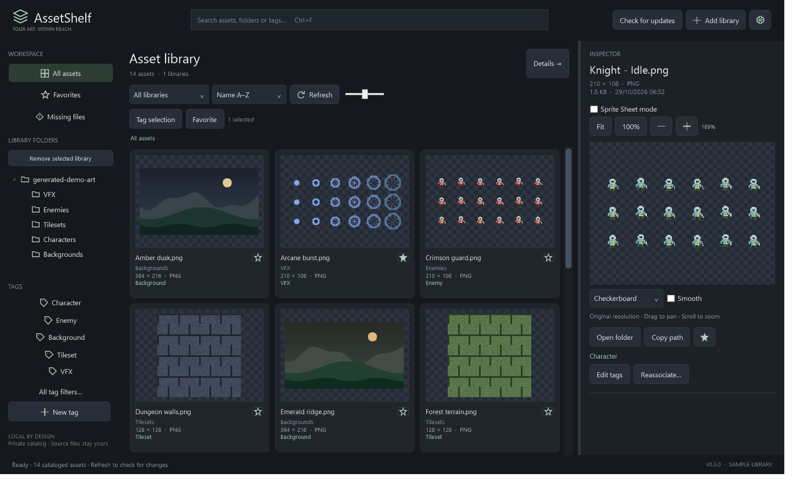
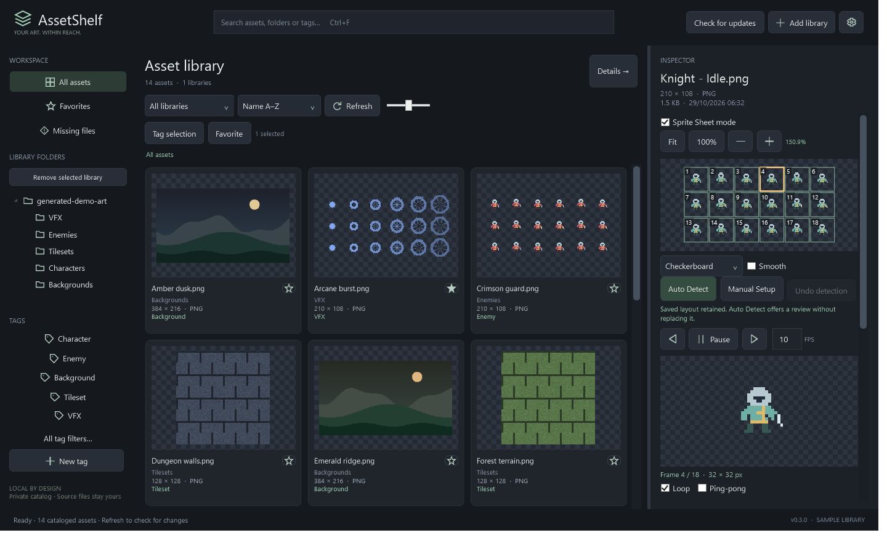

<p align="center">
  
</p>

<h1 align="center">AssetShelf</h1>

<p align="center">Browse your pixel-art collection. Find the right asset. Preview the animation.</p>

<p align="center"><strong><a href="https://github.com/FuegoRoseAI/AssetShelf-Releases/releases/latest">Download the latest Windows release</a></strong> · <a href="https://github.com/FuegoRoseAI/AssetShelf-Releases/releases">Release notes &amp; previous versions</a></p>

AssetShelf is a local Windows desktop browser for game art. Add your existing asset folders, explore thumbnails, search by name, folder or tag, and inspect sprite-sheet animations without moving your original files.



*Actual AssetShelf 0.3.0 interface with generated demo artwork in an isolated catalog. No personal asset collection is shown.*

## Download and install

1. Open the **[latest release](https://github.com/FuegoRoseAI/AssetShelf-Releases/releases/latest)**. The first stable installer is **[AssetShelf-0.3.0-Setup.exe](https://github.com/FuegoRoseAI/AssetShelf-Releases/releases/download/v0.3.0/AssetShelf-0.3.0-Setup.exe)**.
2. Close any running AssetShelf windows before a manual installation or upgrade.
3. Run the installer, follow Setup, and open AssetShelf from the Start menu.
4. Choose **Add library** and select a folder containing your own assets. Subfolders are indexed; your files stay in place.

Requires **Windows 10 or Windows 11 with .NET Framework 4.8 or later already installed**. Setup installs for the current Windows user, normally under `%LOCALAPPDATA%\Programs\AssetShelf`, without requesting administrator privileges. It does not install .NET or image codecs.

**Using the older portable 0.2.0 build?** Run the 0.3.0 installer manually once. The older build has no updater. Under the same Windows account, the installed app uses the existing normal catalog automatically.

## What you can do

- **Browse your collection:** recursive folder libraries, adjustable thumbnails, folder navigation, sorting and a virtualized gallery. Refresh discovers changes; missing files retain their catalog records and can be reassociated.
- **Find useful assets:** search filenames, folder paths and tags, then combine library, folder, favorites and a tag filter.
- **Organize without touching source files:** personal tags, favorites and batch tagging/favoriting live in the local catalog.
- **Inspect artwork clearly:** full-resolution previews, Fit and DPI-aware 100%, pan/zoom, transparent backgrounds and sharp nearest-neighbor rendering, with optional smoothing. Open the source folder or copy an asset's path.
- **Preview sprite-sheet animations:** play/pause, frame stepping, FPS, looping, ping-pong and saved named ranges. Supported metadata can supply frame order and timing.
- **Set up frames with review:** Auto Detect first looks for matching metadata, including supported Aseprite and TexturePacker JSON exports. Without usable metadata, repeated transparency and spacing can suggest uniform grids. Review boundaries and an animation preview before applying; alternatives, manual setup and persistent one-step **Undo detection** are available.
- **Update from the app:** a visible **Check for updates** button, background startup checks, release notes, download progress and cancellation. Downloading and installation require your action.



*Sprite Sheet mode in the actual application. This generated demo sheet uses a saved 32 × 32 layout; it is not a claim that every sheet can be detected automatically.*

## Supported files and detection

| Content | Support in 0.3.0 |
| --- | --- |
| PNG, JPEG/JPG, BMP | Image indexing, thumbnails and previews |
| Still WebP | Requires a compatible Windows WIC codec already installed; availability varies |
| Uniform sprite sheets | Manual frame size, rows/columns, symmetric margins and spacing; reviewable image-based suggestions where evidence exists |
| Aseprite / TexturePacker JSON | Supported hash/array exports with matching source images, unrotated frame rectangles, complete canvas/trim offsets and supported animation definitions |
| Other companion metadata | Compatible JSON rectangle maps, image-bound grid JSON and exact companion TXT rectangle lists |

Image-based detection produces **suggestions, not confirmed layouts**. It preserves each cell's transparent canvas rather than cropping every opaque shape. Dimensions alone are not enough to infer a reliable grid. Irregular atlases need supported metadata; manual grids cannot reconstruct arbitrary packing.

Rotated/mesh-packed frames, custom pivots/anchors, scaled or multi-texture descriptors, and incomplete trimming information are explained and rejected while the original image preview remains usable. Some metadata variants are unsupported even when their exporter name is recognized.

Full previews are limited to **32 megapixels and 16,384 pixels per side**; source files are limited to 256 MB. Image-based detection is limited to 16 megapixels. Very large folder trees may take time to scan. Library changes are picked up with **Refresh / F5**, not a filesystem watcher.

Animation playback here means frames from configured sprite sheets. Animated-file decoding, audio previews, direct copying into game projects, and frame/animation export are not included in 0.3.0.

## Built-in updates

Use **Check for updates** in the main header. AssetShelf also checks shortly after startup without blocking browsing. A check never silently downloads or installs an update.

When a newer stable version is available, review its version and release notes, then choose **Download and install**. Checks and downloads can be cancelled. After verification, AssetShelf saves and closes normally before interactive Setup, then reopens the same catalog profile. Setup never force-closes another running AssetShelf window.

Updates use an AssetShelf-specific RSA-3072/SHA-256 signed manifest and verify the installer's signed size and SHA-256 before execution. HTTPS requests and redirects are restricted to this release repository and approved GitHub asset delivery hosts. Prereleases, downgrades, invalid signatures and expired metadata are rejected. Manifests have a 90-day validity period and must be refreshed by the publisher before expiry.

The public **[stable manifest](https://github.com/FuegoRoseAI/AssetShelf-Releases/releases/latest/download/manifest.json)** is update metadata, not something you need to install manually.

**Manifest signing is separate from Windows Authenticode.** The 0.3.0 application and installer do not have an Authenticode publisher certificate. Keep Windows protections enabled and review normal Windows prompts.

## Your files and local data

Your original artwork remains in the folders you added. AssetShelf stores folder references, tags, favorites, sprite layouts, named animations, detection Undo and preferences in:

```text
%LOCALAPPDATA%\AssetShelf\catalog.json
```

Generated thumbnails are stored beside it under `thumbnails-v1`. Explicit custom `--profile` catalogs remain in their selected directories. Updates save and reuse the same profile; the installer and uninstaller do not delete catalog data or original assets. The normal catalog also keeps a previous-save backup for recovery.

Browsing and organization work offline. Update checks contact GitHub; the updater does not upload your catalog or asset files.

## Release information and repository scope

- **[Latest release and notes](https://github.com/FuegoRoseAI/AssetShelf-Releases/releases/latest)**
- **[0.3.0 release notes](https://github.com/FuegoRoseAI/AssetShelf-Releases/releases/download/v0.3.0/RELEASE-NOTES.md)**
- **[All releases](https://github.com/FuegoRoseAI/AssetShelf-Releases/releases)**

This repository distributes **AssetShelf installers, release notes and public signed update metadata**. **Personal asset packs are not included.** The screenshots use original generated demo artwork; they do not grant access to anyone's private collection.

Application source, private signing keys, credentials and user catalogs are not published here. GitHub-generated **Source code (zip/tar.gz)** archives contain this distribution repository and its product-page media, not AssetShelf's application source.